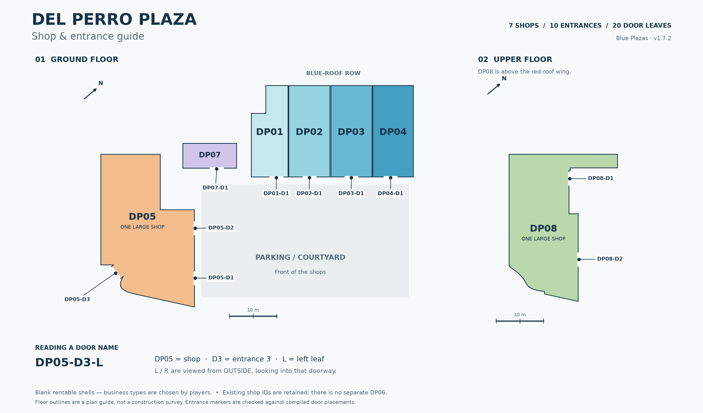

# Blue Plazas (Full ai made)

Seven blank shop interiors at Del Perro Plaza, intended for players to furnish as their own businesses.

## Shop map and door names

[](docs/SHOP_MAP.md)

**[Open the shop and door guide](docs/SHOP_MAP.md)** | [Full-size map PNG](docs/maps/plaza_shop_map.png) | [Door coordinates CSV](docs/maps/door_schedule.csv)

Every shop, entrance and door leaf is labelled. For example, `DP05-D3-L` is the left leaf of DP05's rear entrance, viewed from outside looking in. The labels and coordinates help with player directions, testing and doorlock setup.

## Installation — choose one door-tuning route

> **If your server already uses a custom `gta5.meta`, a `replace_level_meta` resource, or `doortuning.ymt` (including Gabz), you MUST merge the supplied plaza tuning profile and model mapping into your existing central `doortuning.ymt`. Integrate its `DOOR_TUNING_FILE` reference into your existing `gta5.meta` only as needed. Preserve existing entries and unrelated meta settings. Do not overwrite existing files or enable a second competing standalone `gta5.meta` replacement. If the existing reference already points to the central file being updated, leave it unchanged.**

**Tip:** Using an AI coding assistant can make this merge much quicker than doing it manually. Give it your existing `gta5.meta` and `doortuning.ymt` plus the supplied plaza entries, and ask it to preserve existing settings and avoid duplicate profiles or mappings. Back up your files and check the result before installing.

- **No existing central owner:** install `blue_plazas` and the optional `blue_plazas_doortuning` companion as separate sibling resources. Start the companion first, then the plaza. The main MLO does not require Gabz.
- **Existing owner:** keep it, merge the additions, and start `blue_plazas` after it. Do **not** enable the standalone companion.

**[Full installation, exact merge entries and verification](integration/doortuning/README.md)** · [Optional companion source](optional/blue_plazas_doortuning/) · [Downloads](https://github.com/JustBlueDolphin/blue_plazas/releases)

The optional companion uses a pinned AGPL-3.0 vanilla baseline with its license/source notices included. Full Gabz tuning files are not distributed. The new v1.7.2 door setup is file-validated and awaiting game testing.

## Folder structure

```text
blue_plazas/
├── fxmanifest.lua
├── README.md
├── TESTING.md
├── audio/                    # Game audio settings (.dat151.rel)
├── docs/
│   └── STRUCTURE.md          # Folder guide and update instructions
├── tools/
│   └── resource_layout.py    # Validate or organize a build
├── integration/doortuning/   # Plaza-only entries and central-file merge tool
├── optional/                # Standalone companion; enable ONLY when appropriate
└── stream/
    ├── _manifest.ymf         # Interior registration
    ├── interiors/
    │   ├── bp_dp01/          # Each shop's shell, frames, glass, collision and placement
    │   ├── bp_dp02/
    │   ├── bp_dp03/
    │   ├── bp_dp04/
    │   ├── bp_dp05/
    │   ├── bp_dp07/
    │   └── bp_dp08/
    ├── shared/               # Archetypes, common textures and door model
    ├── exterior/
    │   ├── models/           # Building and ground drawables
    │   ├── collision/        # Exterior collision
    │   └── lod/              # Distant building models
    ├── occlusion/            # Visual occlusion map overrides
    └── audio/                # Per-interior numeric audio metadata (.ymt)
```

See [the folder guide](docs/STRUCTURE.md) before updating an existing installation. The folder reorganization preserved all 108 asset names and contents. The subsequent v1.7.2 door update changes only the door archetype's Normal Door attribute in the YTYP.

## Testing v1.7.2

**[Open the full testing checklist](TESTING.md)**

Initial v1.7.1 user feedback was that the visual fixes work so far. The new v1.7.2 folder installation and door tuning are **not yet game-tested**. The checklist covers every shop, front-to-rear visibility, window LOD transitions, doors, collision, surfaces, lighting, audio, multiplayer, and performance.

Current units: `bp_dp01`, `bp_dp02`, `bp_dp03`, `bp_dp04`, `bp_dp05`, `bp_dp07`, and `bp_dp08`.

### Latest fixes to verify

- Storefronts remain visible through the transition to the distant building model, without the plain-panel gap.
- The exterior remains visible through the rear door when viewed from the front of the building.
- The plaza and Gabz copies of `hei_sm_occl_00.ymap` use the same compatible correction. Both copies must remain in sync; a vendor update may replace the Gabz copy.

Make map updates with players disconnected. Use a clean server start and reconnect for validation; a previous live map restart caused a client crash.
