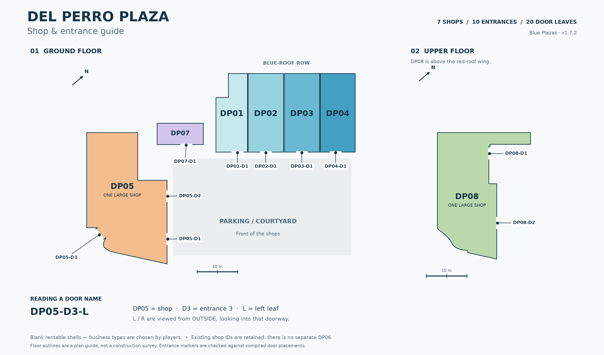

# Shop map and door names

**[Download the full-size PNG](maps/plaza_shop_map.png)** | [Scalable SVG](maps/plaza_shop_map.svg) | [Door coordinates CSV](maps/door_schedule.csv) | [Complete inventory JSON](maps/shop_inventory.json)

Seven blank shops, ten double-door entrances and twenty door leaves. Players choose their own business types. These IDs identify the spaces; they do not assign a food, clothing or electronics shop.

## Find a shop

The map is aligned with the blue-roof row; use its north arrow for world orientation. Ground and upper floors are shown separately. Footprints come from the build layout, with adjoining bay edges joined for readability. This is an identification plan, not a construction survey.

| Shop | Where to find it | MLO archetype | Entrances |
| --- | --- | --- | --- |
| **DP01** | Blue-roof row · tower end | `bp_dp01` | DP01-D1 |
| **DP02** | Blue-roof row · second shop | `bp_dp02` | DP02-D1 |
| **DP03** | Blue-roof row · third shop | `bp_dp03` | DP03-D1 |
| **DP04** | Blue-roof row · outer end | `bp_dp04` | DP04-D1 |
| **DP05** | Large ground-floor corner shop | `bp_dp05` | DP05-D1, DP05-D2, DP05-D3 |
| **DP07** | Ground-floor tower shop | `bp_dp07` | DP07-D1 |
| **DP08** | Large upper-floor shop | `bp_dp08` | DP08-D1, DP08-D2 |

Existing unit numbers are retained. DP05 is one connected ground-floor shop, and DP08 is one connected upper-floor shop. There are no separate active DP06, DP09 or DP10 units in this version.

## Door naming

**`DP05-D3-L` = shop DP05, entrance 3 (the rear entrance), left leaf.**

**L and R are always viewed from outside, looking into that particular doorway.** At the rear door, stand outside at the rear to determine left/right. `D1`, `D2` and `D3` identify entrances, not individual leaves.

| Entrance | Location | Left leaf | Right leaf |
| --- | --- | --- | --- |
| **DP01-D1** | Front entrance | `DP01-D1-L` | `DP01-D1-R` |
| **DP02-D1** | Front entrance | `DP02-D1-L` | `DP02-D1-R` |
| **DP03-D1** | Front entrance | `DP03-D1-L` | `DP03-D1-R` |
| **DP04-D1** | Front entrance | `DP04-D1-L` | `DP04-D1-R` |
| **DP05-D1** | Front · outer entrance | `DP05-D1-L` | `DP05-D1-R` |
| **DP05-D2** | Front · tower-side entrance | `DP05-D2-L` | `DP05-D2-R` |
| **DP05-D3** | Rear entrance | `DP05-D3-L` | `DP05-D3-R` |
| **DP07-D1** | Front entrance | `DP07-D1-L` | `DP07-D1-R` |
| **DP08-D1** | Upper stair / tower entrance | `DP08-D1-L` | `DP08-D1-R` |
| **DP08-D2** | Upper terrace entrance | `DP08-D2-L` | `DP08-D2-R` |

## Doorlock and testing reference

All twenty leaves use **`bp_shop_door`** (model hash `0xF94D22D6`). Their unique names above are documentation/configuration labels; the shared model has not been renamed, and no locks or signs are added automatically. Pair the L/R leaves of the same entrance when configuring a double door.

The CSV and JSON provide each leaf's **closed-door world hinge origin** in GTA V metres. The Z coordinate is the elevated door pivot, not the floor height or a player teleport position. Entity and portal indices are zero-based and local to the named MLO archetype. These are reference data, not a drop-in configuration for a particular doorlock script. Confirm each selected object in game and configure permissions/locking in your chosen doorlock resource.

| Door leaf | World X | World Y | World Z (hinge) |
| --- | ---: | ---: | ---: |
| `DP01-D1-L` | -1540.770 | -427.692 | 35.895 |
| `DP01-D1-R` | -1539.393 | -426.067 | 35.895 |
| `DP02-D1-L` | -1536.246 | -422.350 | 35.895 |
| `DP02-D1-R` | -1534.869 | -420.725 | 35.895 |
| `DP03-D1-L` | -1530.494 | -415.558 | 35.895 |
| `DP03-D1-R` | -1529.118 | -413.933 | 35.895 |
| `DP04-D1-L` | -1525.105 | -409.194 | 35.895 |
| `DP04-D1-R` | -1523.728 | -407.568 | 35.895 |
| `DP05-D1-L` | -1534.082 | -454.492 | 36.165 |
| `DP05-D1-R` | -1535.707 | -453.115 | 36.165 |
| `DP05-D2-L` | -1542.171 | -447.641 | 36.165 |
| `DP05-D2-R` | -1543.797 | -446.265 | 36.165 |
| `DP05-D3-L` | -1547.708 | -465.985 | 36.465 |
| `DP05-D3-R` | -1545.579 | -466.055 | 36.465 |
| `DP07-D1-L` | -1550.343 | -436.143 | 36.165 |
| `DP07-D1-R` | -1548.967 | -434.518 | 36.165 |
| `DP08-D1-L` | -1554.811 | -446.320 | 40.795 |
| `DP08-D1-R` | -1556.436 | -444.943 | 40.795 |
| `DP08-D2-L` | -1540.490 | -455.892 | 40.795 |
| `DP08-D2-R` | -1542.115 | -454.516 | 40.795 |

## Validation and updates

Snapshot: **v1.7.2**. All seven MLOs and all twenty leaves are accounted for. Door origins from the compiled YTYP and placement XML agree with the configured storefront hinge positions within 2 mm. Every leaf belongs to exactly one documented entrance and its existing portal. This is file validation; in-game doorlock selection and walk-through confirmation remain pending.

Use these names in [the testing checklist](../TESTING.md) and issue reports, for example: `DP05-D3-R catches while closing`. After moving a shop, changing openings, or rebuilding door entities, regenerate/check this inventory before relying on the coordinates or indices.

Maintainers can redraw the PNG/SVG from the inventory with `python tools/render_shop_map.py` (Python packages: `matplotlib`, `shapely`). That command redraws the saved snapshot; it does not re-extract new game assets.
